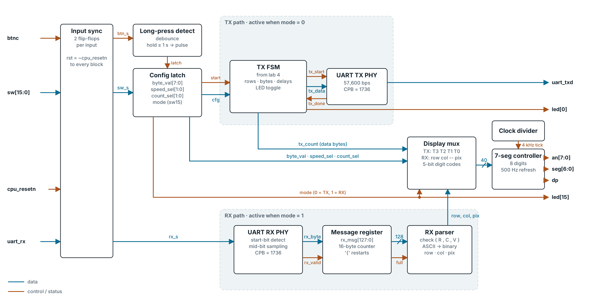

# Lab 5 – UART TX/RX Controller

SystemVerilog UART transmit and receive controller for the Nexys A7-100T (Xilinx Artix-7). In TX mode the board sends a configurable pattern of characters to the PC; in RX mode it receives ASCII messages, validates them and shows the values on the 7-segment display.

Built as part of the Chip Design and Verification program (Google & Reichman University, 2026). The design extends the TX-only controller of Lab 4, rewritten from Verilog to SystemVerilog, and is the base for [Lab 6](https://github.com/DekelSrur/chip_design_lab_6).

**Team:** Dekel Srur, Avi Shevel, May Weiss

## Features

- **UART**, 57,600 baud, 8N1, on a 100 MHz clock (1,736 clocks per bit).
- **Receiver** (`RX_fsm`) with a 2-flip-flop synchronizer and 16x oversampling; the start bit is checked around the middle of the bit and each data bit is sampled at its center.
- **Message parser** (`parser`): accepts `{R___,C___,V___}` messages and rejects out-of-range values and malformed messages as a whole.
- **Transmitter** (`tx_fsm`, `uart_tx`): sends an N x N square of a selected character, with a selectable delay between bytes.
- **Mode select** with a switch: TX or RX, shown on an LED.
- **Parameterized timing**: all counters are parameters of `chip_top`, so the same RTL is simulated with short values and implemented with the real ones.

## Architecture

| Module | Role |
| --- | --- |
| `sync` | Reset synchronizer and input synchronizers |
| `debouncer` | Debouncer for the button and the switches |
| `cfg_latch` | Latches the switch configuration when a transfer starts |
| `tx_fsm`, `uart_tx` | Transmit sequence and UART transmitter (PHY) |
| `RX_fsm` | UART receiver (PHY) |
| `parser` | Decodes and validates received messages |
| `display_mux`, `seg7_ctrl` | 7-segment display driver |
| `chip_top` | Top level; connects the modules |

## Verification

Ten self-checking testbenches, one for every module and one for the whole chip. `TB_RX_fsm` checks the receiver with the real bit time, including a glitch, a framing error and a baud-rate error of ±2%. `tb_chip_top` checks the complete chip through the serial lines in both modes.

## Results

| Item | Result |
| --- | --- |
| Timing at 100 MHz | Met: WNS +0.822 ns, WHS +0.167 ns |
| Resources | 512 LUTs, 654 flip-flops, 36 I/O pins |
| Hardware test | All test cases passed on the board |

## Repository layout

| Folder | Content |
| --- | --- |
| `src/` | RTL modules |
| `tb/` | Testbenches |
| `constr/` | Pin and timing constraints |
| `vivado/` | Vivado project |
| `doc/` | Block diagrams and FSM diagrams |

## Known limitations

The receiver stays active during a transmission; blocking RX while TX is busy is not implemented.
